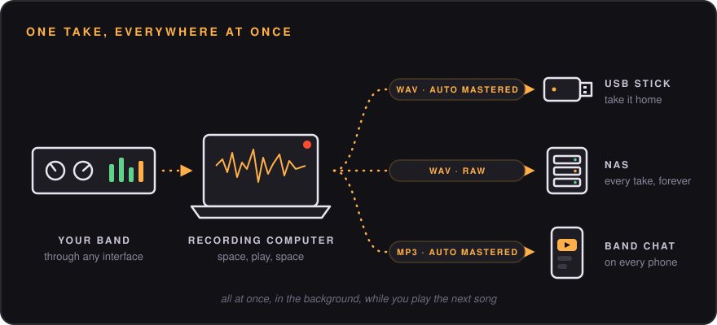
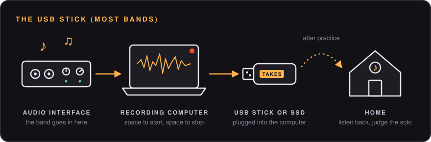
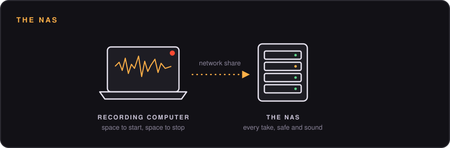
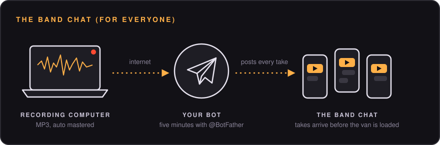
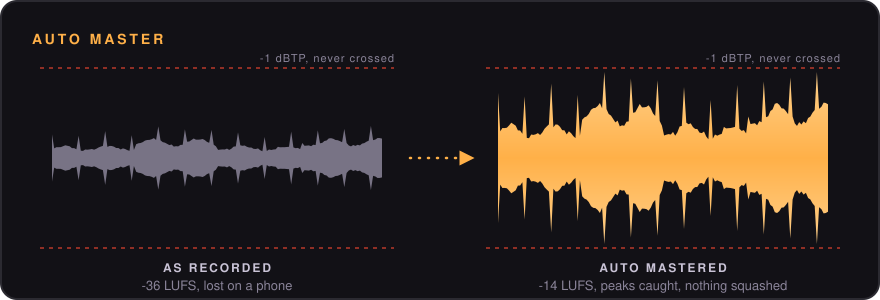
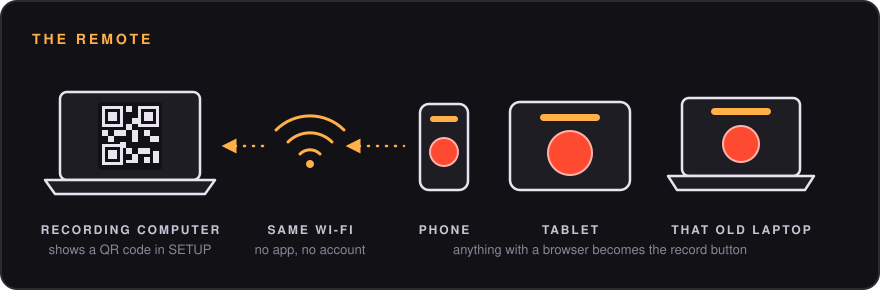

<div align="center">


# PracticeSpaceRecorder

**Press space. Play loud. Press space.**<br/>
Your take is already saved, and you're halfway into the next song.

[](https://github.com/corrooli/PracticeSpaceRecorder/releases/latest)


[](https://ko-fi.com/olivercorrodi)

<br/>


</div>

<br/>

## The entire manual

1. Press <kbd>SPACE</kbd>.
2. Play your song.
3. Press <kbd>SPACE</kbd>.

That's it. There is no step 4. Step 4 is playing the next song.

<br/>

## Why this exists

Every band knows this moment. Someone plays a riff that is *actually good*. Everyone yells "record that!". Then someone spends four minutes opening a DAW, making a new project, arming tracks, picking a folder, naming a file, and by then the riff is gone forever, along with the drummer's patience.

PracticeSpaceRecorder is the opposite of that. It boots straight into a ready state with everything already set up: input, channels, format, where the files go. Your USB stick or NAS is checked in the background. A row of LEDs tells you at a glance that everything is fine. Then there is one big button, and the button is your space bar.

Built for the practice space of [Naked Soldier](http://www.nakedsoldier.ch/). Shared because your band deserves it too.

<br/>

## Pick your setup

PracticeSpaceRecorder writes every take to one or more **destinations**: a folder on the computer, a USB stick, an external drive, a NAS, or straight into your band's Telegram chat. Use one, use all of them, the app doesn't judge.



Every destination gets its own format: a loud WAV to listen to at home, the raw WAV for mixing later, a small MP3 for the phones.

### The USB stick (what most bands want)

Plug a USB stick or an external SSD/HDD into the recording computer, make it a destination, and play. After practice, grab the stick and take it home. That's the whole workflow.



Forgot the stick at home? Keep recording anyway. Takes wait on the computer and copy themselves over the next time you plug it in.

### The NAS (for the slightly obsessed)

If your practice space has a NAS or any network share, takes can go straight there. Nobody has to remember a stick, and nobody "accidentally" takes it home for three weeks.



### The band chat (for bands that live on their phones)

Add a **Telegram** destination and a bot posts every take into your group chat, ready to play, before the van is loaded.



Pair it with a USB stick or the NAS: the chat gets a handy MP3, the drive keeps the full quality WAV. See [Sending takes to Telegram](#sending-takes-to-telegram).

<br/>

## What it does

| | |
|---|---|
| **One key** | <kbd>SPACE</kbd> starts, <kbd>SPACE</kbd> stops. Nothing else is needed during practice. |
| **Never misses the one** | A 2 second pre-roll keeps the audio from *before* you pressed the key. Nobody hits it exactly on the downbeat. Now it doesn't matter. |
| **Presets that stay put** | Mono, stereo or full multitrack, input channels, track names, format, file naming and destinations. Saved on disk, loaded on start. Switch with the arrows. |
| **Waveforms you can read from the drum riser** | Every track gets a full width lane with peak and RMS, clip markers and a dB-scaled view, so "is the bass too hot?" takes half a second to answer. |
| **Saves in the background** | When you stop, the take is written to every destination (local disk, USB stick, external drive, NAS, all of them at once) while you're already recording the next one. |
| **Lose nothing, ever** | Audio goes to a local buffer first. USB stick unplugged? NAS asleep? The take waits and delivers itself when the destination is back, even after a restart. Power cut mid-take? The audio up to that point is recovered on next launch. |
| **Straight to the band chat** | A Telegram bot posts every take into your group, as MP3 so it doesn't eat everyone's data plan. |
| **Loud enough, automatically** | Practice recordings are usually way too quiet. The auto master brings every take up to a healthy level and keeps the peaks from clipping. No knobs, no presets, switch it off per destination if you want the raw file. |
| **WAV or MP3, per destination** | Full quality WAV on the drive, small MP3s for the chat, or whatever mix you like. More than two tracks become a stereo mix for MP3. |
| **Auto-connects your NAS** | Give it an `smb://` address and it mounts the share by itself (using your Keychain login on the Mac). |
| **Remote control** | Any phone, tablet or laptop on your Wi-Fi can be the record button. Scan a QR code and you're done. No app needed. |
| **Stays out of the way** | Opens in fullscreen, keeps the computer from sleeping while recording, and asks nothing. |
| **Big files are fine** | WAV files switch to RF64 automatically, so a 16 track jam session can run for hours without hitting the 4 GB WAV limit. |

<br/>

<table>
<tr>
<td width="58%"></td>
<td width="42%"></td>
</tr>
<tr>
<td align="center"><sub>The preset editor. Every input has a live meter, so you find the right channel by just playing.</sub></td>
<td align="center"><sub>An old tablet makes a great record button. Far away from the table edge and your guitar's headstock.</sub></td>
</tr>
</table>

<br/>

## Install

### The easy way (one line)

Open **Terminal** (Mac) or your terminal (Linux), paste this, press Enter:

```bash
curl -fsSL https://raw.githubusercontent.com/corrooli/PracticeSpaceRecorder/main/install.sh | bash
```

Want it to open by itself every time the computer starts? Add `--autostart`:

```bash
curl -fsSL https://raw.githubusercontent.com/corrooli/PracticeSpaceRecorder/main/install.sh | bash -s -- --autostart
```

The script picks the right download for your computer, installs it, and opens it. Run it again any time to update.

### The click-around way

Go to the [**latest release**](https://github.com/corrooli/PracticeSpaceRecorder/releases/latest) and download the file for your computer:

| Your computer | Download |
|---|---|
| Mac with Apple chip (M1, M2, M3, M4…) | `PracticeSpaceRecorder_x.y.z_aarch64.dmg` |
| Mac with Intel chip | `PracticeSpaceRecorder_x.y.z_x64.dmg` |
| Ubuntu, Debian, Mint, Pop!_OS | `PracticeSpaceRecorder_x.y.z_amd64.deb` |
| Fedora, openSUSE | `PracticeSpaceRecorder-x.y.z-1.x86_64.rpm` |
| Any other Linux | `PracticeSpaceRecorder_x.y.z_amd64.AppImage` |

<details>
<summary><b>Mac: installing the .dmg</b></summary>

1. Open the `.dmg` and drag **PracticeSpaceRecorder** into **Applications**.
2. Open it from Applications.
3. macOS will say it can't check the app for malicious software (older versions may even call it "damaged", it isn't). That's because we don't pay Apple for a developer certificate every year. To open it anyway:
   * Open **System Settings → Privacy & Security**, scroll down, and click **Open Anyway** next to PracticeSpaceRecorder.
   * Or run this once in Terminal: `xattr -dr com.apple.quarantine /Applications/PracticeSpaceRecorder.app`
4. Allow microphone access when asked. (The microphone is your audio interface. We promise we're not listening to your band. Well, we are, but only when you press space.)

</details>

<details>
<summary><b>Linux: installing the .deb / .rpm / AppImage</b></summary>

```bash
# Ubuntu / Debian / Mint
sudo apt install ./PracticeSpaceRecorder_*_amd64.deb

# Fedora
sudo dnf install ./PracticeSpaceRecorder-*.rpm

# AppImage: make it executable and run it
chmod +x PracticeSpaceRecorder_*.AppImage && ./PracticeSpaceRecorder_*.AppImage
```

Your user needs to be in the `audio` group on some distributions: `sudo usermod -aG audio $USER`, then log out and back in.

</details>

<br/>

## First time setup (about 3 minutes)

1. Click **PRESETS** (top right).
2. Pick your **input device** and **sample rate**.
3. Choose **MONO**, **STEREO** or **MULTITRACK**, then click the channels you want. Play something: the little meters on each channel button show you which input is which.
4. Name your tracks if you like (Kick, Snare, Gtr L…). Names end up in the file names.
5. Under **DESTINATIONS**, set where takes go. Add as many as you want: local folder, USB stick, external drive, NAS.
6. Hit **SAVE & USE**.

From now on the app starts exactly like this, every time. Make more presets for different setups ("Full band multitrack", "Acoustic duo", "Drummer is sick again") and flip between them with the arrows next to the preset name.

<br/>

## Recording to a USB stick or external drive

1. Plug in the drive.
2. In **PRESETS → DESTINATIONS**, click **+ ADD DESTINATION**, pick **LOCAL FOLDER** and hit **BROWSE**. Pick a folder on the drive, for example `/Volumes/BANDSTICK/Takes` on a Mac or `/media/you/BANDSTICK/Takes` on Linux.
3. Leave the local folder in there as a second destination. Then there is always a copy on the computer too, in case the stick goes through the washing machine.

Before you pull the stick out, check that the **DELIVERY** LED is green (nothing left to write), then eject it like you normally would. If it's not plugged in, its LED goes red, takes pile up safely on the computer, and they get copied over once the stick is back.

<br/>

## Recording to a NAS or network share

Click **+ ADD DESTINATION**, pick **NETWORK SHARE** and paste the address of the folder on your NAS:

```
smb://you@nas.local/music/Band
```

That's server, share, then the folder inside it. The app splits it up for you right below the field, so typos are easy to spot. Hit **TEST** and it connects the share, writes a test file, reads it back and tells you where takes will land (and how much room is left).

Connecting happens by itself whenever the share is missing. On a Mac it uses Finder's mount and your Keychain password (you log in once, then never again). On Linux it uses `gio mount`, or you can set your own **mount command** under **Advanced…** (for example `mount /mnt/nas` with an fstab entry).

And if the NAS is off, asleep, or someone tripped over the network cable: **keep recording**. Takes wait in the local buffer, the status LED turns red, and everything is delivered the moment the share is back.

<br/>

## Auto master

Interfaces in practice rooms are set with lots of headroom (good, nothing clips), which makes the recordings quiet (bad, you can't hear them on a phone). So before a take is written, PracticeSpaceRecorder listens to all of it once and then:




* turns it up to about the loudness of a streaming service (-14 LUFS),
* catches the peaks with a look-ahead limiter so nothing clips, not even after MP3 encoding (-1 dBTP),
* takes out sub-bass rumble nobody hears but every speaker has to move for.

It never squashes: the limiter shaves a few dB off the loudest hits at most, quiet takes get a bit less loud instead. Silence stays silence, and takes that are loud already are left as they are. It's not a mastering engineer, but your phone speaker won't know the difference.

Files meant for mixing (one file per track, or multichannel WAVs) are always left untouched. Want the raw take everywhere? Switch **Auto master** off on the destination.

<br/>

## Sending takes to Telegram

1. In Telegram, message **@BotFather**, send `/newbot`, pick a name. It gives you a **token** (looks like `123456789:AAH4x...`).
2. Add your new bot to the band group and say anything in there, so the bot knows the group exists.
3. In **PRESETS → DESTINATIONS**, click **+ ADD DESTINATION**, pick **TELEGRAM** and paste the token.
4. Hit **FIND CHATS**, click your group, then **TEST**. The bot says hi in the chat. Hit **SAVE**.

Takes arrive as playable audio with the preset, take name, length and date. Telegram lets bots upload 50 MB per file, so long takes first drop to 128 kbps and, if they're still too big, arrive in parts ("Take 03 (1 of 2)"). If the internet is down, takes wait and go out later, like everywhere else. A take that was halfway out continues where it stopped instead of posting the first part twice.

The token is kept on the recording computer only. Once saved, the app shows it as `••••abcd` and never hands it out again, not even to the remote. If it ever leaks anyway, send `/revoke` to @BotFather and paste the new one.

<br/>

## The remote

The recording computer is often in a corner, behind the amps, under a pile of cables. So any phone, tablet or laptop on the same Wi-Fi can be the record button instead. It runs in the browser, so there's nothing to install and it works on whatever device is lying around.



1. Open **SETUP**. You'll see a QR code and an address like `http://192.168.1.20:7878`.
2. Scan the QR code with the device's camera, or type the address into any browser.
3. Optional: use your browser's **Add to Home Screen** for a fullscreen remote with a huge REC button.

Remotes can record, stop and switch presets. Only the recording computer can change settings, so nobody edits your presets from the couch.

<br/>

## Reading the LEDs

The status strip is the whole "is everything OK?" check.

| LED | Means |
|---|---|
| 🟢 green | Ready. Go play. |
| 🟠 amber, blinking | Working on it: opening the interface, connecting the NAS, writing a take. |
| 🔴 red | Needs a look. Hover it to see why. Recording still works unless it's the **INPUT** LED. |

* **SYSTEM** is the summary. Green **READY** means press space and stop worrying.
* **INPUT** is your audio interface, sample rate and channels.
* One LED **per destination**, with free space.
* **DELIVERY** shows takes still being written. Click it to retry failed ones right now.
* **BUFFER DISK** shows how many hours of recording still fit on the local disk at your current track count.
* **REMOTE** shows connected tablets and phones.

<br/>

## Keys

| Key | Does |
|---|---|
| <kbd>SPACE</kbd> | Record / stop. The only one you need. |
| <kbd>←</kbd> <kbd>→</kbd> | Previous / next preset |
| <kbd>F</kbd> | Toggle fullscreen |
| <kbd>Esc</kbd> | Close the preset or setup panel |

<br/>

## File names

The default is `{date}/{date} {time} {preset} take {take}`, which gives you one folder per practice:

```
2026-11-08/
  2026-11-08 19-48-03 Band Practice take 01.wav
  2026-11-08 20-02-41 Band Practice take 02.wav
```

| Token | Becomes |
|---|---|
| `{date}` | `2026-11-08` |
| `{time}` | `19-48-03` |
| `{take}` | `01`, `02`… (restarts every day) |
| `{preset}` | name of the preset |
| `{year}` `{month}` `{day}` | `2026` `11` `08` |

A `/` makes a folder. In multitrack mode, turn on **One file per track** to get a folder of mono files (`01 Kick.wav`, `02 Snare.wav`…) ready to drag into any DAW.

<br/>

## FAQ

**Does it work with my audio interface?**<br/>
If your computer sees it as an input, yes. Focusrite, MOTU, RME, Behringer, the cheap one from the music store with a broken knob, all of them. On Linux it works through ALSA, which also covers PipeWire and PulseAudio setups.

**What happens if the computer crashes in the middle of a take?**<br/>
The audio is streamed to disk the whole time. On the next start, the take is recovered and delivered like any other one. You lose maybe a fraction of a second.

**WAV or MP3?**<br/>
Both, if you like. Keep WAV on the drive, because you might want to mix that one magic take later, and send MP3s to the band chat so nobody's data plan cries. You pick per destination.

**Do I need a NAS?**<br/>
Nope. Most bands don't have one, and that's fine. A local folder is the default destination, and a USB stick is all you need to take the takes home.

**Can the drummer use it?**<br/>
It has one button. Yes.

**Is the remote safe on a shared network?**<br/>
Anyone on the same network can start and stop recordings, and that's all they can do. If that's a problem, turn remote control off in **SETUP**.

<br/>

## Build it yourself

You need [Node.js](https://nodejs.org) 20+ and [Rust](https://rustup.rs). On Linux also: `libwebkit2gtk-4.1-dev librsvg2-dev libasound2-dev patchelf`.

```bash
git clone https://github.com/corrooli/PracticeSpaceRecorder.git
cd PracticeSpaceRecorder
npm install
npm run app       # run it
npm run bundle    # build installers into src-tauri/target/release/bundle
```

How it fits together: a Rust core (audio capture with [cpal](https://github.com/RustAudio/cpal), a lock-free ring buffer, the delivery queue, share mounting) serves the UI over a local web server. The app window is a native [Tauri](https://tauri.app) window showing that UI, and tablets load the very same page over Wi-Fi. One UI, two doors.

Releases are built by GitHub Actions: push a tag like `v1.0.1` and installers for every platform show up in a draft release.

<br/>

## Buy me a coffee

PracticeSpaceRecorder is free and stays free. If it saved a riff your band would otherwise have forgotten, you can [buy me a coffee on Ko-fi](https://ko-fi.com/olivercorrodi). It goes straight into more coffee, new strings and the occasional replacement for whatever the drummer broke.

<a href="https://ko-fi.com/olivercorrodi"></a>

<br/>

## License

[AGPL-3.0](LICENSE). Use it, change it, share it. If you ship a changed version, share your changes too.

<div align="center">
<br/>
<sub>Made with too much coffee and slightly too loud amps, in a practice space that smells like old carpet.</sub>
</div>
