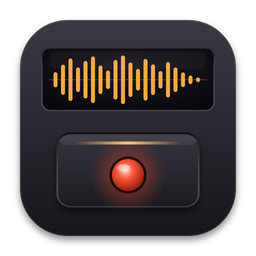
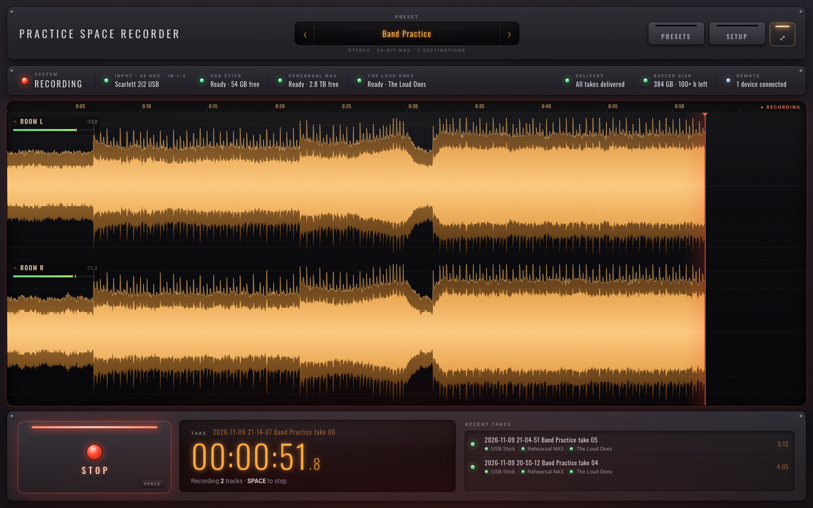
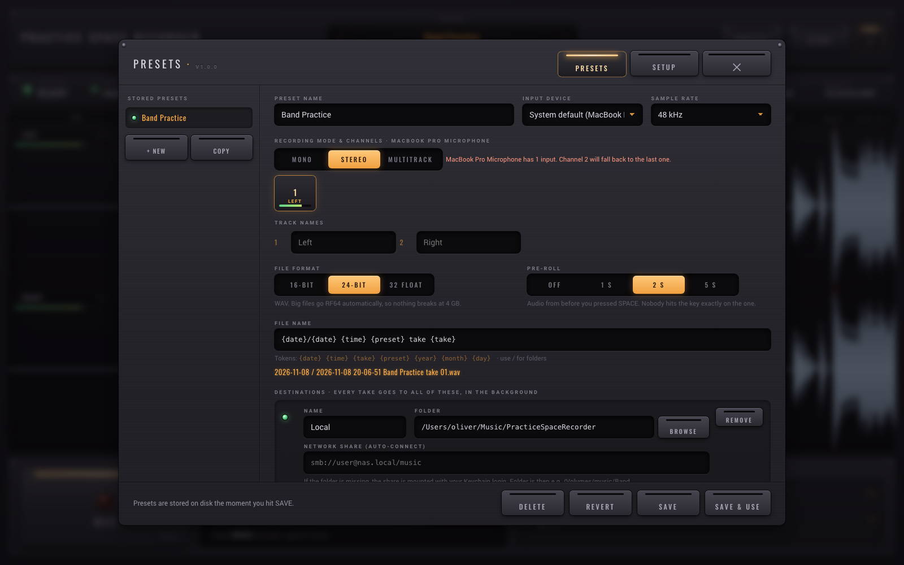
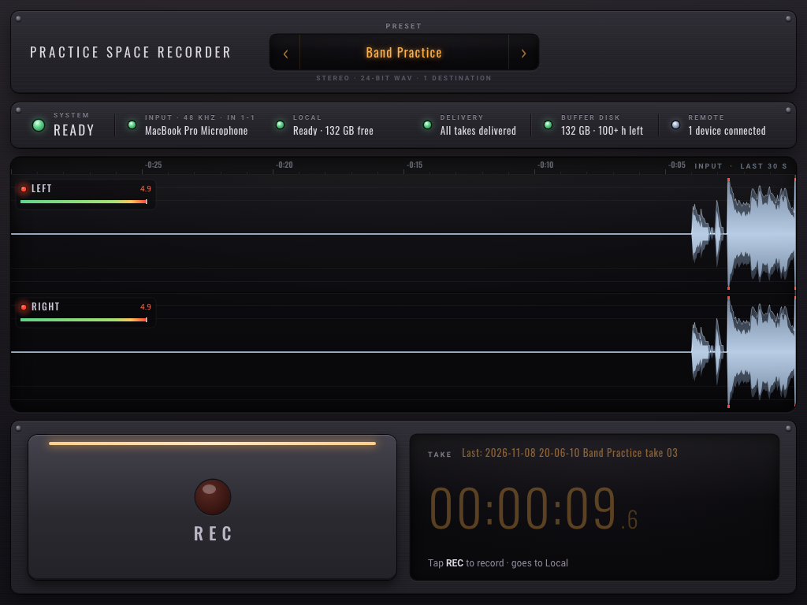

<div align="center">



# PracticeSpaceRecorder

**Press space. Play loud. Press space.**<br/>
Your take is already on the NAS, and you're halfway into the next song.

[](https://github.com/corrooli/PracticeSpaceRecorder/releases/latest)


<br/>



</div>

<br/>

## The entire manual

1. Press <kbd>SPACE</kbd>.
2. Play your song.
3. Press <kbd>SPACE</kbd>.

That's it. There is no step 4. Step 4 is playing the next song.

<br/>

## Why this exists

Every band knows this moment. Someone plays a riff that is *actually good*. Everyone yells "record that!". Then someone spends four minutes opening a DAW, making a new project, arming tracks, picking a folder, naming a file, and by then the riff is gone forever, along with the drummer's patience.

PracticeSpaceRecorder is the opposite of that. It boots straight into a ready state with everything already set up: input, channels, format, where the files go. The network share is connected in the background. A row of LEDs tells you at a glance that everything is fine. Then there is one big button, and the button is your space bar.

Built for the practice space of [Naked Soldier](http://www.nakedsoldier.ch/). Shared because your band deserves it too.

<br/>

## What it does

| | |
|---|---|
| **One key** | <kbd>SPACE</kbd> starts, <kbd>SPACE</kbd> stops. Nothing else is needed during practice. |
| **Never misses the one** | A 2 second pre-roll keeps the audio from *before* you pressed the key. Nobody hits it exactly on the downbeat. Now it doesn't matter. |
| **Presets that stay put** | Mono, stereo or full multitrack, input channels, track names, format, file naming and destinations. Saved on disk, loaded on start. Switch with the arrows. |
| **Waveforms you can read from the drum riser** | Every track gets a full width lane with peak and RMS, clip markers and a dB-scaled view, so "is the bass too hot?" takes half a second to answer. |
| **Saves in the background** | When you stop, the take is written to every destination (local disk, NAS, SMB share, all of them at once) while you're already recording the next one. |
| **Lose nothing, ever** | Audio goes to a local buffer first. NAS asleep? The take waits and delivers itself when the share is back, even after a restart. Power cut mid-take? The audio up to that point is recovered on next launch. |
| **Auto-connects your NAS** | Give it an `smb://` address and it mounts the share by itself (using your Keychain login on the Mac). |
| **iPad remote** | Any tablet or phone on your Wi-Fi can be the record button. Scan a QR code and you're done. No app needed. |
| **Stays out of the way** | Opens in fullscreen, keeps the computer from sleeping while recording, and asks nothing. |
| **Big files are fine** | WAV files switch to RF64 automatically, so a 16 track jam session can run for hours without hitting the 4 GB WAV limit. |

<br/>

<table>
<tr>
<td width="58%"></td>
<td width="42%"></td>
</tr>
<tr>
<td align="center"><sub>The preset editor. Every input has a live meter, so you find the right channel by just playing.</sub></td>
<td align="center"><sub>An old iPad makes a great record button. Far away from the table edge and your guitar's headstock.</sub></td>
</tr>
</table>

<br/>

## Install

### The easy way (one line)

Open **Terminal** (Mac) or your terminal (Linux), paste this, press Enter:

```bash
curl -fsSL https://raw.githubusercontent.com/corrooli/PracticeSpaceRecorder/main/install.sh | bash
```

Want it to open by itself every time the computer starts? Add `--autostart`:

```bash
curl -fsSL https://raw.githubusercontent.com/corrooli/PracticeSpaceRecorder/main/install.sh | bash -s -- --autostart
```

The script picks the right download for your computer, installs it, and opens it. Run it again any time to update.

### The click-around way

Go to the [**latest release**](https://github.com/corrooli/PracticeSpaceRecorder/releases/latest) and download the file for your computer:

| Your computer | Download |
|---|---|
| Mac with Apple chip (M1, M2, M3, M4…) | `PracticeSpaceRecorder_x.y.z_aarch64.dmg` |
| Mac with Intel chip | `PracticeSpaceRecorder_x.y.z_x64.dmg` |
| Ubuntu, Debian, Mint, Pop!_OS | `PracticeSpaceRecorder_x.y.z_amd64.deb` |
| Fedora, openSUSE | `PracticeSpaceRecorder-x.y.z-1.x86_64.rpm` |
| Any other Linux | `PracticeSpaceRecorder_x.y.z_amd64.AppImage` |

<details>
<summary><b>Mac: installing the .dmg</b></summary>

1. Open the `.dmg` and drag **PracticeSpaceRecorder** into **Applications**.
2. Open it from Applications.
3. macOS will say it can't check the app for malicious software (older versions may even call it "damaged", it isn't). That's because we don't pay Apple for a developer certificate every year. To open it anyway:
   * Open **System Settings → Privacy & Security**, scroll down, and click **Open Anyway** next to PracticeSpaceRecorder.
   * Or run this once in Terminal: `xattr -dr com.apple.quarantine /Applications/PracticeSpaceRecorder.app`
4. Allow microphone access when asked. (The microphone is your audio interface. We promise we're not listening to your band. Well, we are, but only when you press space.)

</details>

<details>
<summary><b>Linux: installing the .deb / .rpm / AppImage</b></summary>

```bash
# Ubuntu / Debian / Mint
sudo apt install ./PracticeSpaceRecorder_*_amd64.deb

# Fedora
sudo dnf install ./PracticeSpaceRecorder-*.rpm

# AppImage: make it executable and run it
chmod +x PracticeSpaceRecorder_*.AppImage && ./PracticeSpaceRecorder_*.AppImage
```

Your user needs to be in the `audio` group on some distributions: `sudo usermod -aG audio $USER`, then log out and back in.

</details>

<br/>

## First time setup (about 3 minutes)

1. Click **PRESETS** (top right).
2. Pick your **input device** and **sample rate**.
3. Choose **MONO**, **STEREO** or **MULTITRACK**, then click the channels you want. Play something: the little meters on each channel button show you which input is which.
4. Name your tracks if you like (Kick, Snare, Gtr L…). Names end up in the file names.
5. Under **DESTINATIONS**, set where takes go. Add as many as you want: local folder, NAS, external drive.
6. Hit **SAVE & USE**.

From now on the app starts exactly like this, every time. Make more presets for different setups ("Full band multitrack", "Acoustic duo", "Drummer is sick again") and flip between them with the arrows next to the preset name.

<br/>

## Recording to a NAS or network share

Add a destination and fill in two things:

| Field | Mac example | Linux example |
|---|---|---|
| **Folder** | `/Volumes/music/Band` | `/run/user/1000/gvfs/smb-share:server=nas.local,share=music/Band` |
| **Network share** | `smb://you@nas.local/music` | `smb://nas.local/music` |

When the folder isn't there, PracticeSpaceRecorder connects the share for you. On a Mac it uses Finder's mount and your Keychain password (you log in once, then never again). On Linux it uses `gio mount`, or you can set your own **mount command** (for example `mount /mnt/nas` with an fstab entry).

And if the NAS is off, asleep, or someone tripped over the network cable: **keep recording**. Takes wait in the local buffer, the status LED turns red, and everything is delivered the moment the share is back.

<br/>

## The iPad (or phone) remote

1. Open **SETUP**. You'll see a QR code and an address like `http://192.168.1.20:7878`.
2. Scan it with the iPad camera, or type the address into Safari.
3. Tap **Share → Add to Home Screen** for a fullscreen remote with a huge REC button.

Remotes can record, stop and switch presets. Only the recording computer can change settings, so nobody edits your presets from the couch.

<br/>

## Reading the LEDs

The status strip is the whole "is everything OK?" check.

| LED | Means |
|---|---|
| 🟢 green | Ready. Go play. |
| 🟠 amber, blinking | Working on it: opening the interface, connecting the NAS, writing a take. |
| 🔴 red | Needs a look. Hover it to see why. Recording still works unless it's the **INPUT** LED. |

* **SYSTEM** is the summary. Green **READY** means press space and stop worrying.
* **INPUT** is your audio interface, sample rate and channels.
* One LED **per destination**, with free space.
* **DELIVERY** shows takes still being written. Click it to retry failed ones right now.
* **BUFFER DISK** shows how many hours of recording still fit on the local disk at your current track count.
* **REMOTE** shows connected tablets and phones.

<br/>

## Keys

| Key | Does |
|---|---|
| <kbd>SPACE</kbd> | Record / stop. The only one you need. |
| <kbd>←</kbd> <kbd>→</kbd> | Previous / next preset |
| <kbd>F</kbd> | Toggle fullscreen |
| <kbd>Esc</kbd> | Close the preset or setup panel |

<br/>

## File names

The default is `{date}/{date} {time} {preset} take {take}`, which gives you one folder per practice:

```
2026-11-08/
  2026-11-08 19-48-03 Band Practice take 01.wav
  2026-11-08 20-02-41 Band Practice take 02.wav
```

| Token | Becomes |
|---|---|
| `{date}` | `2026-11-08` |
| `{time}` | `19-48-03` |
| `{take}` | `01`, `02`… (restarts every day) |
| `{preset}` | name of the preset |
| `{year}` `{month}` `{day}` | `2026` `11` `08` |

A `/` makes a folder. In multitrack mode, turn on **One file per track** to get a folder of mono files (`01 Kick.wav`, `02 Snare.wav`…) ready to drag into any DAW.

<br/>

## FAQ

**Does it work with my audio interface?**<br/>
If your computer sees it as an input, yes. Focusrite, MOTU, RME, Behringer, the cheap one from the music store with a broken knob, all of them. On Linux it works through ALSA, which also covers PipeWire and PulseAudio setups.

**What happens if the computer crashes in the middle of a take?**<br/>
The audio is streamed to disk the whole time. On the next start, the take is recovered and delivered like any other one. You lose maybe a fraction of a second.

**Why WAV and not MP3?**<br/>
Because you might want to mix that one magic take later. Make MP3s from it when you share it with the band chat.

**Can I use it without a NAS?**<br/>
Of course. A local folder is the default destination. Add a USB drive as a second one for a backup.

**Can the drummer use it?**<br/>
It has one button. Yes.

**Is the remote safe on a shared network?**<br/>
Anyone on the same network can start and stop recordings, and that's all they can do. If that's a problem, turn remote control off in **SETUP**.

<br/>

## Build it yourself

You need [Node.js](https://nodejs.org) 20+ and [Rust](https://rustup.rs). On Linux also: `libwebkit2gtk-4.1-dev librsvg2-dev libasound2-dev patchelf`.

```bash
git clone https://github.com/corrooli/PracticeSpaceRecorder.git
cd PracticeSpaceRecorder
npm install
npm run app       # run it
npm run bundle    # build installers into src-tauri/target/release/bundle
```

How it fits together: a Rust core (audio capture with [cpal](https://github.com/RustAudio/cpal), a lock-free ring buffer, the delivery queue, share mounting) serves the UI over a local web server. The app window is a native [Tauri](https://tauri.app) window showing that UI, and tablets load the very same page over Wi-Fi. One UI, two doors.

Releases are built by GitHub Actions: push a tag like `v1.0.1` and installers for every platform show up in a draft release.

<br/>

## License

[AGPL-3.0](LICENSE). Use it, change it, share it. If you ship a changed version, share your changes too.

<div align="center">
<br/>
<sub>Made with too much coffee and slightly too loud amps, in a practice space that smells like old carpet.</sub>
</div>
